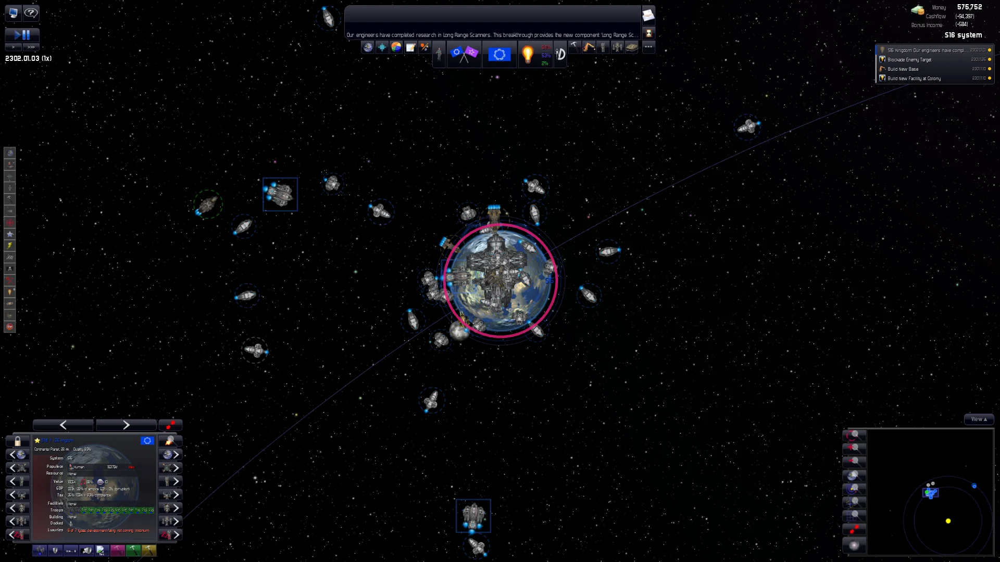
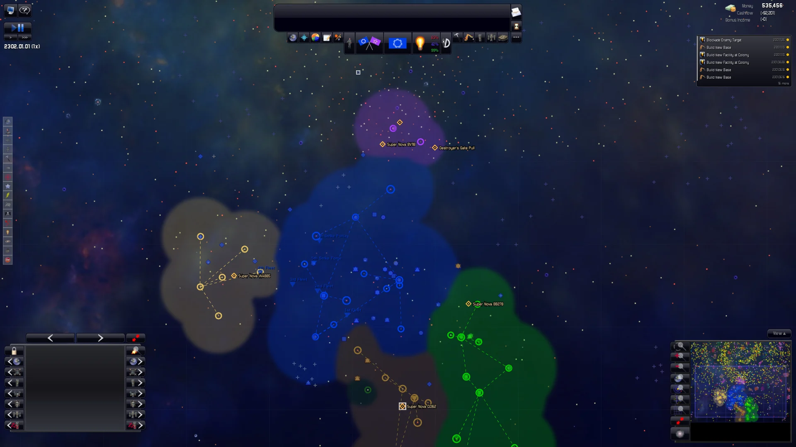
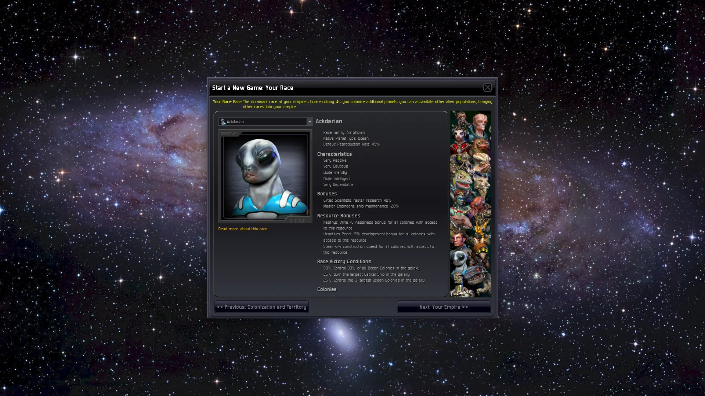
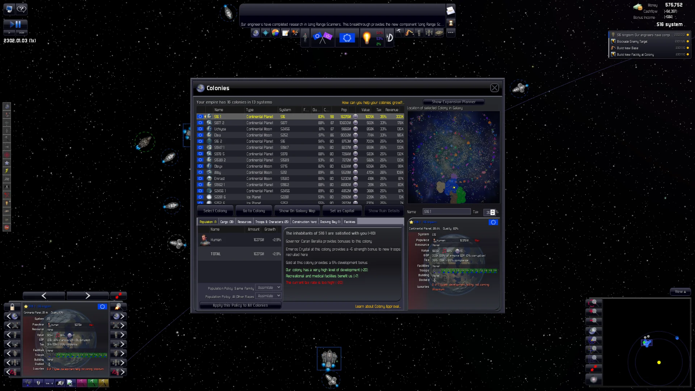
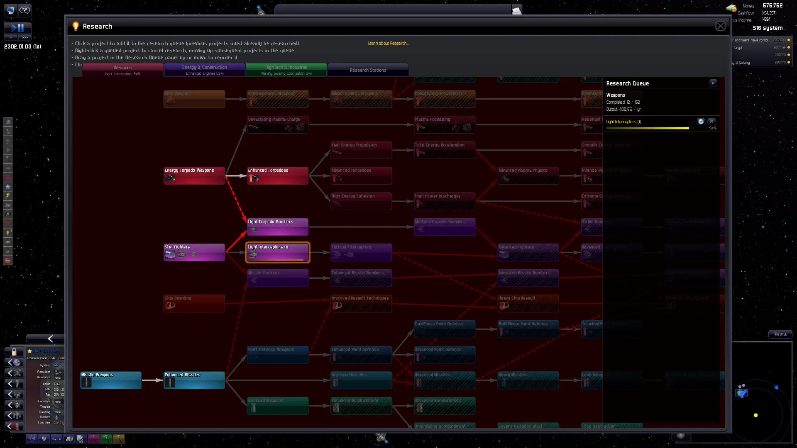

<div align="center">

# openDWU

**A faithful recreation of *Distant Worlds: Universe* (v1.9.5) in TypeScript and PixiJS.**

[](https://github.com/jfj-oss/openDWU/releases/latest)
[](#install)
[](LICENSE)



</div>

> [!IMPORTANT]
> **You need your own copy of the original game's data files.** This
> repository ships no original art, sounds, data or decompiled source; the
> game reads them at runtime from your own Distant Worlds: Universe install
> folder (your Steam install, or on a Mac a copy of the game folder from a PC
> where you own and installed the game).

openDWU is new code written in TypeScript, with an opt-in mod/scenario layer
on top. **No code from the original game is copied into this project.** The
decompiled original was used only as a reference for gameplay accuracy, so
that formulas, constants, generation order and the random-number sequence
play out the same way. The code lives under [`game/`](game/). It is a free,
non-commercial fan project: nothing is sold and no donations are taken.
It is unofficial and not affiliated with or endorsed by Slitherine, Matrix
Games or Code Force. Don't have the game?
[Buy *Distant Worlds: Universe* on Steam](https://store.steampowered.com/app/261470/).

## Why this exists

Beloved game Distant Worlds: Universe ported to all operating systems (Linux/Windows x86 & Mac OS ARM) 

Made with intention of removing the barrier of entry posed by incompatibility with newer operating systems. This is not using copied code, but code is based on decompiled data for accuracy of gameplay systems.

Made with generative AI, I mostly acted as guidance; eyes and ears (aka: guinea pig)

<div align="center">

| [**▶ How to play**](#install) | [**Windows**](#windows) | [**macOS**](#macos) | [**Linux**](#linux) |
|:---:|:---:|:---:|:---:|
| start here | install on Windows 10/11 | install on Apple silicon | install on Linux |

| [Won't start?](#distant-worlds-universe-wont-start-or-keeps-crashing) | [What's here](#whats-here) | [Screenshots](#screenshots) | [Themes & mods](#themes-modded-content) | [Troubleshooting](#troubleshooting) |
|:---:|:---:|:---:|:---:|:---:|

</div>

## Distant Worlds: Universe won't start or keeps crashing?

The original game is a 2014 Windows program built on Microsoft's .NET
Framework and the XNA Framework 4.0 (a DirectX 9 game library that is no
longer maintained). On current systems players commonly run into:

- the game not launching, or closing straight away on Windows 10 / 11;
- errors about a missing or broken **XNA Framework** or **.NET Framework**;
- a black screen or graphics errors on start-up;
- "out of memory" crashes in big galaxies or late games;
- no way to play it on a **Mac** (Steam says it is incompatible and won't
  download it) or natively on **Linux**.

openDWU doesn't fix the original program; it replaces it. It is a new
engine, written to match the original's rules, that plays the same game using
the data files from your own install. It needs no XNA, .NET Framework or
DirectX 9, and runs as a native 64-bit app on **Windows, macOS (Apple
silicon) and Linux**. It finds your Steam install by itself, plays
Universe 1.9.5 (which includes all the earlier expansions), works with
modded themes, and is free and open source.

**[Download the latest release](https://github.com/jfj-oss/openDWU/releases/latest)**, then follow
[Install](#install) for your system.

## What's here

- **A faithful port of DW:U 1.9.5**: the original engine's formulas,
  constants, order of operations and seeded `System.Random` sequence, with
  thousands of seed-pinned values to catch regressions.
- **One seamless map.** Scroll continuously from the whole galaxy down to a
  single planet and back. The galaxy and system views are the same map at
  different zoom levels, cross-fading instead of switching screens.
- **Desktop apps for macOS, Linux and Windows.** They find your Steam
  install, remember your game folder and offer new releases. You can also
  run the game from source in the browser.
- **Five opt-in expansions and mods.** With every expansion off the game is
  the stock port. Each expansion is one switch on the new-game wizard's
  Scenario page: **The Rim** (rim trade, frontier, creatures and herders),
  **Politics & Characters** (governors, VIP shuttles, the Galactic Council,
  the Interstellar Diet), **Economy** (the Colony Economy, exchange, chartered
  companies, privateers), **Galactic Threats** (hidden end-game threats such
  as the Cult, the Hive and Dark Farms) and **Living Galaxy** (livelier AI,
  active independents, colony defence). Each one's members can also be
  switched off alone ([details](game/docs/EXPANSIONS.md)).
- **Multiplayer over a LAN or the Internet.** Players join by code or invite
  (no server to run), a game can be resumed from a multiplayer save, and if
  the host leaves the successor takes over ([how](game/docs/MULTIPLAYER.md)).
- **Improvements inspired by Distant Worlds 2**: battle reports, supply-chain
  visibility, waypoints, a Fleet Settings panel, and resource, fuel-range and
  colony-score overlays. You can switch each one off in Game Options →
  Improvements.
- **Modded themes work out of the box.** Any theme in your install's
  `Customization` folder (Star Trek, Mass Effect, Warhammer 40,000, …) can
  be switched on from the main menu ([how](#themes-modded-content)).
- **Bacon mod settings per game.** Every game keeps its own
  `BaconSettings.txt` values, and you can edit them at any time from Game
  Options.
- **Deterministic and replayable.** A seed plus the player's command log
  reproduces a game exactly.

## Screenshots

<table>
  <tr>
    <td width="50%"></td>
    <td width="50%"></td>
  </tr>
  <tr>
    <td align="center"><sub>Zoomed out: empire territories over the nebulae</sub></td>
    <td align="center"><sub>New game wizard: choosing your race</sub></td>
  </tr>
  <tr>
    <td width="50%"></td>
    <td width="50%"></td>
  </tr>
  <tr>
    <td align="center"><sub>The Colonies window, over the map</sub></td>
    <td align="center"><sub>The research tree and queue</sub></td>
  </tr>
</table>

## Install

1. Download the app for your system from the
   [**latest release**](https://github.com/jfj-oss/openDWU/releases/latest).
2. Start it and, if it doesn't find your Distant Worlds: Universe folder by
   itself, point it at that folder once.
3. Play. New versions are offered automatically.

The apps aren't code-signed (a free hobby project), so Windows and macOS
need one extra click the first time; each section below says which. The
dropdowns have the full details and how to run from source.

**openDWU or openDWU Classic?** Each release comes in two editions, built
from the same code:

- **openDWU** (files named `openDWU-<version>-…`): the full game with the
  optional add-ons you can switch on when starting a new game.
- **openDWU Classic** (files named `openDWU-Classic-<version>-…`): the base
  game plus the Bacon mod and openDWU's fixes, with no gameplay add-ons;
  only themed names, the smarter AI option and the event log.

Pick one; you can also install both. Classic keeps its own settings and
saves (an `openDWU Classic` folder next to the full edition's
`Distant Worlds Universe` folder) and updates to new Classic releases.
The steps below use the full edition's names; for Classic the app is
called **dwu-classic** instead of **dwu**.

---

## Windows

1. Download **`openDWU-<version>-windows-x64-setup.exe`** from the
   [latest release](https://github.com/jfj-oss/openDWU/releases/latest).
2. Run it. If Windows says *"Windows protected your PC"*, click
   **More info → Run anyway**.
3. Start **openDWU** from the Start menu. It finds your Steam copy of the game
   by itself; if not, click **Choose Folder…** and pick the game's folder.

<details>
<summary><b>More details: desktop app (portable zip, game folder, updates, uninstall)</b></summary>

**1. Download** `openDWU-<version>-windows-x64-setup.exe` from the
[latest release](https://github.com/jfj-oss/openDWU/releases/latest). (There
is also a portable `openDWU-<version>-windows-x64.zip`: extract it anywhere
and run `dwu.exe`.) If your browser says the file "isn't commonly
downloaded", choose **Keep**.

**2. Run the installer.** The app is unsigned, so Windows SmartScreen shows
"Windows protected your PC": click **More info**, then **Run anyway**. The
installer needs no administrator rights: it installs for your user (by
default to `%LOCALAPPDATA%\Programs\dwu`) and adds **openDWU** to the Start
menu and the desktop.

**3. First launch.** openDWU looks for your Distant Worlds: Universe folder in
every Steam library (it reads Steam's location from the registry and the
other libraries, e.g. on `D:`, from Steam's `libraryfolders.vdf`), then in
`C:\Program Files (x86)\Steam\steamapps\common\Distant Worlds Universe`.
If it finds none, a setup window asks for the folder: click
**Choose Folder…** and pick the folder that contains `images` and
`races.txt` (in Steam: right-click the game → **Manage** → **Browse local
files** opens it). Picking the Steam library or `steamapps` folder above it
also works. The choice is remembered.

Installed the game somewhere other than Steam? Pick that install folder in
the setup window. You don't need Node.js or npm for the app.

To use another folder later, press **Ctrl+Shift+O** in the game and choose
**Game Folder…** (the same menu has **Check for Updates…**).

**4. Updates.** When a new release is out, the app offers it at startup
(every launch): **Download** opens the new installer in your browser;
run it and it replaces the old version (settings and saves are kept).

**Uninstall:** Settings → Apps → **openDWU**. Your settings and saves stay in
`%APPDATA%\Distant Worlds Universe`; delete that folder too to remove them.

</details>

<details>
<summary><b>Run from source (browser)</b></summary>

**1. Install Node.js and git**

```powershell
winget install --id OpenJS.NodeJS.LTS -e
winget install --id Git.Git -e
```

Close and reopen PowerShell so `node` and `git` are on your PATH, then check:

```powershell
node -v    # must print v22.12 or newer
git --version
```

**2. Clone openDWU and install dependencies**

```powershell
cd $HOME
git clone https://github.com/jfj-oss/openDWU.git
cd openDWU\game
npm ci
```

**3. Link the game data**

`npm run import-assets` is a bash script and does **not** work on Windows.
Create a directory junction instead (no administrator rights or Developer
Mode needed). Run this from `openDWU\game`, changing the path if your Steam
library is somewhere else (e.g. `D:\SteamLibrary\steamapps\common\Distant Worlds Universe`):

```powershell
$DwuDir = "C:\Program Files (x86)\Steam\steamapps\common\Distant Worlds Universe"
New-Item -ItemType Directory -Force public\assets | Out-Null
New-Item -ItemType Junction -Path public\assets\dwu -Target $DwuDir
```

The folder must contain an `images` subfolder. Nothing is copied; the
junction just points at your install. If the game is installed somewhere
else, set `$DwuDir` to that folder instead.

**4. Run the game**

```powershell
npm run dev
```

Open the URL it prints (normally <http://localhost:5173/>) in your browser.
Windows Firewall may ask about Node.js because the dev server also listens
on your local network; allowing "Private networks" is enough. Stop the
server with `Ctrl+C`.

**5. Optional: build the desktop app yourself**

```powershell
npm run package:win    # -> release\dwu-win32-x64\dwu.exe
npm run dist:win       # also the installer and zip in release\upload\
```

**6. Update to the latest version**

From `openDWU\game`, with the dev server stopped:

```powershell
git pull
npm ci
npm run dev
```

The junction from step 3 is kept across updates.

</details>

---

## macOS

Apple silicon (M1 and later).

1. Download **`openDWU-<version>-macos-arm64.dmg`** from the
   [latest release](https://github.com/jfj-oss/openDWU/releases/latest) and
   drag **dwu** to **Applications**.
2. Get the game files: Steam for Mac won't download Distant Worlds: Universe,
   so copy the whole `Distant Worlds Universe` folder from a PC where you own
   the game to **`~/Games/Distant Worlds Universe`** (other ways in the
   details below).
3. First time only: **Control-click dwu → Open → Open**. (macOS 15 and later:
   open it once, then **System Settings → Privacy & Security → Open Anyway**.)

<details>
<summary><b>More details: desktop app (opening an unsigned app, other ways to get the game files, updates)</b></summary>

**1. Download** `openDWU-<version>-macos-arm64.dmg` from the
[latest release](https://github.com/jfj-oss/openDWU/releases/latest), open
it and drag **dwu** onto **Applications**. (Intel Macs: there is no Intel
build; run from source in the browser below.)

**2. First launch (once).** The app is not signed with an Apple Developer ID,
so a plain double-click is refused ("dwu can't be opened" / "Apple could not
verify…"). Open it once like this:

- In **Applications**, **Control-click** (or right-click) **dwu** → **Open** →
  **Open**.
- On macOS 15 Sequoia and later, if there is no Open button: double-click
  **dwu** once, then open **System Settings → Privacy & Security**, scroll to
  the message about "dwu", click **Open Anyway** and confirm.
- Or in Terminal: `xattr -dr com.apple.quarantine /Applications/dwu.app`

After that it opens normally (also after updates installed the same way).

**3. Game files.** Distant Worlds: Universe is a Windows game, so a Mac has no
native install; Steam for Mac won't download it at all (it shows the game as
incompatible). openDWU only needs its files, not a working Windows game. On
first launch a setup window asks for the folder and explains the options:

- **Steam for Windows inside [Whisky](https://getwhisky.app/) or
  [CrossOver](https://www.codeweavers.com/crossover):** install DW:U there;
  openDWU finds it inside the bottle automatically
  (`…/drive_c/Program Files (x86)/Steam/steamapps/common/Distant Worlds Universe`).
- **A copy from a Windows or Linux PC** (simplest): on a PC where you own and installed the
  game, copy the whole `Distant Worlds Universe` folder (Steam → right-click
  the game → Manage → Browse local files) to the Mac, e.g. over USB or the
  network, to `~/Games/Distant Worlds Universe`, which is also found
  automatically, or anywhere else and pick it with **Choose Folder…**.
- **Download the Windows version with SteamCMD:** Valve's command-line
  Steam client can download the Windows files directly on the Mac, for
  your own Steam account and your own copy of the game. Install it from
  Valve's developer site or with `brew install --cask steamcmd`, then run
  (261470 is DW:U's Steam app id):

  ```sh
  steamcmd +@sSteamCmdForcePlatformType windows \
    +force_install_dir ~/Games/Distant\ Worlds\ Universe \
    +login <your Steam username> +app_update 261470 validate +quit
  ```

  Replace `<your Steam username>` with your own. SteamCMD asks for your
  password and Steam Guard code, and the download
  only works if your account owns the game. The files land in
  `~/Games/Distant Worlds Universe`, which is found automatically.

You don't need Node.js or npm for the app.

To use another folder later: **Distant Worlds Universe** menu → **Game
Folder…** (next to **Check for Updates…**).

**4. Updates.** When a new release is out, the app offers it at startup (every
launch): **Download** opens the new disk image in your browser;
drag **dwu** to Applications again, replacing the old one, and repeat the
one-time step 2. Settings and saves are kept.

</details>

<details>
<summary><b>Run from source (browser)</b></summary>

**1. Install Node.js and git**

Install [Homebrew](https://brew.sh) if you don't have it:

```sh
/bin/bash -c "$(curl -fsSL https://raw.githubusercontent.com/Homebrew/install/HEAD/install.sh)"
```

On Apple Silicon (M1 and later), Homebrew installs to `/opt/homebrew`; if
`brew` is "command not found" afterwards, run the two `echo`/`eval` lines
the installer prints under "Next steps", or:

```sh
eval "$(/opt/homebrew/bin/brew shellenv)"
```

Then:

```sh
brew install node git
node -v    # must print v22.12 or newer
```

**2. Get the game data**

There is no native macOS version of Distant Worlds: Universe, and Steam for
Mac won't download it (it shows the game as incompatible). Use one of:

- **A copy from a Windows or Linux PC** (simplest): on a PC where you own
  and installed the game, copy the whole `Distant Worlds Universe` folder
  (the one containing `images/`) to the Mac, e.g. over USB or the network,
  to `~/Games/Distant Worlds Universe` (or anywhere else; then use that
  path below).
- **SteamCMD:** download the Windows version directly on the Mac with
  Valve's command-line Steam client, for your own Steam account and your
  own copy of the game (261470 is DW:U's Steam app id):

  ```sh
  brew install --cask steamcmd
  steamcmd +@sSteamCmdForcePlatformType windows \
    +force_install_dir ~/Games/Distant\ Worlds\ Universe \
    +login <your Steam username> +app_update 261470 validate +quit
  ```

  Replace `<your Steam username>` with your own. It asks for your password
  and Steam Guard code; the download only works if your account owns the
  game.

**3. Clone openDWU, install dependencies and link the data**

```sh
cd ~
git clone https://github.com/jfj-oss/openDWU.git
cd openDWU/game
npm ci
```

`import-assets` has no macOS default path, so always pass `DWU_DIR`
(the folder from step 2):

```sh
DWU_DIR="$HOME/Games/Distant Worlds Universe" npm run import-assets
```

It prints `linked ... -> public/assets/dwu` (a symlink; nothing is copied).

**4. Run the game**

```sh
npm run dev
```

Open the URL it prints (normally <http://localhost:5173/>). Stop it with `Ctrl+C`.

**5. Optional: build the desktop app yourself (Apple silicon)**

```sh
npm run package:mac    # -> release/dwu-darwin-arm64/dwu.app (signed ad hoc when built on the Mac)
npm run dist:mac       # also the disk image in release/upload/
open release/dwu-darwin-arm64/dwu.app
```

See [`game/desktop/README.md`](game/desktop/README.md) for details, e.g.
building the Mac app on Linux and re-signing it on the Mac.

**6. Update to the latest version**

From `~/openDWU/game`, with the dev server stopped:

```sh
git pull
npm ci
npm run dev
```

</details>

---

## Linux

x86_64.

1. Download **`openDWU-<version>-linux-x64.AppImage`** from the
   [latest release](https://github.com/jfj-oss/openDWU/releases/latest).
2. Make it executable and run it:
   `chmod +x openDWU-*-linux-x64.AppImage && ./openDWU-*-linux-x64.AppImage`
3. It finds your Steam copy of the game by itself; if not, click
   **Choose Folder…** and pick the game's folder.

<details>
<summary><b>More details: desktop app (tar.gz, FUSE, game folder, updates)</b></summary>

**1. Download** from the
[latest release](https://github.com/jfj-oss/openDWU/releases/latest) either

- `openDWU-<version>-linux-x64.AppImage`: one file; make it executable and
  run it from the folder you downloaded it to:

  ```bash
  cd ~/Downloads
  chmod +x openDWU-*-linux-x64.AppImage
  ./openDWU-*-linux-x64.AppImage
  ```

  AppImages need FUSE 2: if it does not start, install it
  (Ubuntu 24.04: `sudo apt install libfuse2t64`; Ubuntu 22.04 / Debian:
  `libfuse2`; Fedora: `fuse-libs`; Arch: `fuse2`), or run it with
  `--appimage-extract-and-run`.

- or `openDWU-<version>-linux-x64.tar.gz`: the same app as a plain folder,
  for when the AppImage won't run (no FUSE 2 and you can't install it) or
  you'd rather keep the app in a folder of your choice. Extract it anywhere
  and run `openDWU-<version>-linux-x64/dwu`.

**2. First launch.** openDWU looks for the game in every Steam library it can
find (`~/.local/share/Steam`, `~/.steam/steam`, Flatpak and Snap Steam, and
the extra libraries listed in Steam's `libraryfolders.vdf`), plus
`~/Games/Distant Worlds Universe`. If it finds none, a setup window asks for
the folder: click **Choose Folder…** and pick the folder containing
`images` and `races.txt` (in Steam: right-click the game → Manage → Browse
local files), or paste its path. The choice is remembered.

Installed the game somewhere other than Steam? Pick that install folder in
the setup window. You don't need Node.js or npm for the app.

To use another folder later, press **Ctrl+Shift+O** in the game and choose
**Game Folder…** (the same menu has **Check for Updates…**).

**3. Updates.** When a new release is out, the app offers it at startup (every
launch): **Download** opens the new AppImage (or tar.gz) in your
browser; replace the old file with it. Settings and saves
(`~/.config/Distant Worlds Universe`) are kept.

</details>

<details>
<summary><b>Run from source (browser)</b></summary>

**1. Install Node.js and git**

Arch / CachyOS / Manjaro:

```bash
sudo pacman -S --needed nodejs npm git
```

Debian / Ubuntu (the distro's Node is usually too old; this uses NodeSource's Node 22):

```bash
curl -fsSL https://deb.nodesource.com/setup_22.x | sudo -E bash -
sudo apt-get install -y nodejs git
```

Fedora:

```bash
sudo dnf install nodejs npm git
```

Check the version:

```bash
node -v    # must print v22.12 or newer
```

**2. Get the game data**

If DW:U is installed through Steam at the default location,
`~/.local/share/Steam/steamapps/common/Distant Worlds Universe`, there is
nothing to do here. Otherwise note where your copy is (another Steam
library, Flatpak Steam at
`~/.var/app/com.valvesoftware.Steam/.local/share/Steam/steamapps/common/Distant Worlds Universe`,
or a non-Steam install).

**3. Clone openDWU, install dependencies and link the data**

```bash
cd ~
git clone https://github.com/jfj-oss/openDWU.git
cd openDWU/game
npm ci
```

Default Steam location:

```bash
npm run import-assets
```

Anywhere else:

```bash
DWU_DIR="<path to your DW:U folder>" npm run import-assets
```

It prints `linked ... -> public/assets/dwu` (a symlink; nothing is copied).

**4. Run the game**

```bash
npm run dev
```

Open the URL it prints (normally <http://localhost:5173/>). Stop it with `Ctrl+C`.

**5. Optional: build the desktop app yourself (x86_64)**

```bash
npm run package:linux   # -> release/dwu-linux-x64/dwu
npm run dist:linux      # also the AppImage and tar.gz in release/upload/
release/dwu-linux-x64/dwu
```

The Windows app (`npm run package:win` / `dist:win`) also builds on Linux;
the Mac app (`npm run package:mac`) too, but it must be re-signed on the Mac,
see [`game/desktop/README.md`](game/desktop/README.md).

**6. Update to the latest version**

From `~/openDWU/game`, with the dev server stopped:

```bash
git pull
npm ci
npm run dev
```

</details>

---

## Themes (modded content)

Themes made for the original game, also called customization sets, work in
openDWU unchanged. A theme can replace races, empire policies, ship designs
and names, and the game's art, sounds and music.

<details>
<summary><b>How to install and switch themes</b></summary>

1. **Put the theme in your install's `Customization` folder.** That is the
   folder of the Distant Worlds: Universe install openDWU uses: in Steam,
   right-click the game → **Manage** → **Browse local files** → `Customization`.
   It already holds the themes that ship with the game, such as
   `Distant Worlds Original`. A theme is one folder inside it, for example
   `Customization/Mass Effect 4 Mod/`. If a download unpacks to an extra
   folder level, move the theme folder up so that its `about.txt`, `images`
   and so on sit directly inside it.
2. **Switch to it in the game.** On the main menu, click **Change Theme**,
   pick the theme on the left (its description and picture show on the
   right) and click **Switch Theme**. The game reloads with the theme
   active and remembers it for next time.
3. **Back to the original:** **Change Theme** → **(Default)** → **Switch
   Theme**.

Notes:

- Files load the way the original loads them: each one comes from the theme
  when the theme has it, and from the base game otherwise. Partial themes
  (art only, music only) work too.
- Some themes include prebuilt galaxy maps (`maps/*.dwg`). Those can't be
  loaded yet; the rest of such a theme works.

</details>

---

## Music & mood

**Options → Sound Volume → Music & Mood...** (Escape menu → Options, or
Options on the main menu) holds two independent choices:

- **Background mood:** **Off** (default), **Rim only** (the Rim Atmosphere
  add-on's ambience; greyed out in games without that add-on) or **Deep
  Space**: sparse wind, a deep underwater rumble and, now and then, a
  distant creature call or a hull creak, everywhere in the game. All of it
  is synthesised by openDWU (no sound files). It follows the Effects volume
  and has its own Level slider.
- **Music:** **Original** (the game's soundtrack), **Off**, or one of your
  own playlists, with **Shuffle** and **Next Track**.

<details>
<summary><b>How to add your own playlists</b></summary>

The desktop app keeps a `Music` folder next to your saves, created on first
run with a short `README.txt`:

- Windows: `%APPDATA%\Distant Worlds Universe\Music`
- macOS: `~/Library/Application Support/Distant Worlds Universe/Music`
- Linux: `~/.config/Distant Worlds Universe/Music`

**Open Music Folder** in the Music & Mood window opens it. Each subfolder is
one playlist, named after the folder (for example `Music/Ambient/…`).
Supported files: `.mp3`, `.ogg`, `.opus`, `.flac`, `.wav`, `.m4a` and `.aac`.
The list is read again each time the window opens; empty, unreadable or
unsupported files are skipped with a short note.

In the browser build, **Choose Folder...** picks a folder of music for the
current session only.

</details>

---

## Local language model (optional)

openDWU can use a small language model running on your own computer to give
the galaxy a voice. It is text only (no microphone, no speech), nothing goes
to the internet, and **the game plays exactly as normal without it**: every
model feature is off until you turn it on.

**What it adds**

- **Advisor chat** (press **K**): talk to your fleet admiral in plain words;
  orders they agree to are carried out like any other order.
- **Voices**: messages, advisor briefings, faction ultimatums, council
  speeches and AI diplomats' replies are written in character instead of the
  stock text.
- **Chronicle**: a yearly history of your empire on the Galactic History
  screen.
- **Ask and Orders**: on Galactic History, ask questions about what your
  empire knows, or type an order and confirm the command it becomes.
- **Speak freely**: on the Diplomacy screen, write what you offer and want
  ("5000 credits and Tarsis IV for a defence pact"). The model turns it into a
  proper trade offer, you confirm it, and the game's own rules decide whether
  the other empire accepts. Treaties can be traded for money, colonies or
  tech, and after a refusal you get up to three counter-offers. With another
  human player your words go along with the offer.
- **Rulers' memory**: AI rulers remember wars, gifts, treaties and deals, and
  it slowly shifts how they feel about you.
- **Model-driven strategy**: the AI empires nearest you each make one
  deliberate move a year (peace terms, war goals, council votes and so on).

The model can only suggest things the game would allow anyway; the game checks
and applies each one. If the model is slow, missing or gives a bad answer,
you simply get the normal text and the game carries on.

**Getting it running**

1. Install [Ollama](https://ollama.com/download) (Windows, macOS or Linux).
   It runs quietly in the background.
2. Download a model: open a terminal (Windows: PowerShell) and run

   ```sh
   ollama pull qwen3:4b
   ```

   That is about 2.5 GB. It runs well on an ordinary graphics card, and on
   the CPU too (slower, but the game never waits for it).
3. In openDWU open **Game Options → Local model…**, leave the server on
   **Ollama**, press **Refresh**, choose `qwen3:4b`, then **Test** and
   **Apply**. LM Studio and llama.cpp's `llama-server` work too: pick them in
   the same window.
4. Press **K** in a game to try the advisor chat. For everything else start a
   **New Game**, open **Work in progress** in the add-ons list, tick **Local
   LLM Layer** and the features you want. **Voices** and **Real diplomatic
   negotiation** are good ones to start with.

These features are new and still marked work in progress, so expect rough
edges; bug reports are welcome. Design notes:
`game/tasks/18-local-llm-diplomacy.md` and
`game/tasks/19-mod-layer-scenarios.md` §19s.

---

## Troubleshooting

Desktop app:

- **macOS: "dwu can't be opened" / "is damaged" / "Apple could not verify".**
  The app is unsigned; do the one-time step 2 of [macOS](#macos). If it
  still says "damaged", run `xattr -dr com.apple.quarantine /Applications/dwu.app`.
- **Windows: "Windows protected your PC".** Click **More info** → **Run
  anyway** (unsigned app, see [Windows](#windows) step 2).
- **Linux: the AppImage does nothing / mentions `libfuse.so.2`.** Install FUSE
  2 (see [Linux](#linux) step 1) or use the tar.gz.
- **Linux tar.gz: "The SUID sandbox helper binary was found, but is not
  configured correctly".** Your distro restricts user namespaces (e.g. Ubuntu
  24.04). Start it as `./dwu --no-sandbox`, use the AppImage (which does this
  automatically when needed), or make the helper setuid:
  `sudo chown root:root chrome-sandbox && sudo chmod 4755 chrome-sandbox`.
- **Placeholder art in the desktop app / wrong game folder.** Open the game
  folder setting (macOS: app menu → **Game Folder…**; Windows/Linux:
  **Ctrl+Shift+O** → **Game Folder…**) and pick the folder with `images`
  and `races.txt`.
- **Automatic updates.** The Windows setup install and the Linux AppImage
  download a new release in the background and install it when you quit
  (**Check for Updates…** then offers **Restart now**); the macOS app, the
  Windows zip and the Linux tar.gz offer the download instead.
- **No update prompts.** The check runs on every launch and only offers
  full releases (not pre-releases); use **Check for Updates…** in the same
  menu to check now. To turn the launch check off, add
  `"checkForUpdates": false` to `config.json` in the settings folder
  (Windows `%APPDATA%\Distant Worlds Universe`, macOS
  `~/Library/Application Support/Distant Worlds Universe`, Linux
  `~/.config/Distant Worlds Universe`).

- **Logs.** Crashes and errors are written to `crash-log.txt` in the settings
  folder: Windows `%APPDATA%\Distant Worlds Universe`, macOS
  `~/Library/Application Support/Distant Worlds Universe`, Linux
  `~/.config/Distant Worlds Universe`. Attach that file to a bug report.

From source:

- **Planets, ships and UI show plain generated placeholder art.** The game
  data isn't linked. Redo step 3 for your platform, then restart
  `npm run dev` (it regenerates `public/asset-manifest.json` from the linked
  folder on every start; the file list is not picked up while the server is
  running).
- **`DW:U install not found at ...`** (macOS/Linux). The path passed to
  `import-assets` has no `images/` folder. Check the path and its quoting.
  The script's default is the Linux Steam path, so macOS always needs `DWU_DIR`.
- **`New-Item : An item with the specified name ... already exists`** (Windows).
  Remove the old link first with `cmd /c rmdir public\assets\dwu` (this
  removes only the junction, not your game files), then rerun step 3.
- **`npm ci` reports `EBADENGINE`, or Vite/Vitest fail with syntax errors.**
  Your Node is too old; install Node 22.12 or newer and run `npm ci` again.
- **Port 5173 is already in use.** Vite picks the next free port
  (5174, ...) automatically; open the URL it prints.
- **`npm run import-assets` fails on Windows.** Expected; it is a bash
  script. Use the junction from the [Windows](#windows) step 3.
- **`npm run test:fast` / `test:slow` fail on Windows.** They set an
  environment variable with bash syntax; see [Tests](#tests).

**Still stuck?** [Report a bug](https://github.com/jfj-oss/openDWU/issues/new/choose)
(the form asks for your OS, version and log file), or ask in
[Discussions](https://github.com/jfj-oss/openDWU/discussions).

## Tests

Run from `game/`:

```sh
npm run test:fast          # everything except the slow soak tests, for iterating
npm test                   # the full test suite
npm run repin -- --check   # verify the seed-pinned ("golden pin") values are still up to date
npm run typecheck
```

On Windows PowerShell, run the fast tier as
`$env:DWU_TEST_TIER = "fast"; npx vitest run` (and
`Remove-Item Env:DWU_TEST_TIER` afterwards); `npm test` works as is.

---

## About the project

- **Faithful to the original.** Game logic in `game/src/sim/` is our own
  TypeScript, written to behave like the original engine: same formulas, same
  order of operations, same seeded `System.Random` sequence. No original code
  is copied; the decompiled original was used only as a reference for that
  gameplay accuracy. Results are cross-checked
  against the original data files (`races.txt`, `resources.txt`, `Policy/`,
  `designTemplates/`, …).
- **Deterministic simulation.** The sim is a headless model (no DOM/Pixi
  imports) that is fully determined by a seed plus the sequence of player
  commands: a saved seed and command log reproduce an identical game byte
  for byte, including under a real-time driver with irregular frames, pauses
  and skewed wall clocks (`game/test/commandReplay.test.ts`).
- **Golden pins.** Thousands of seed-dependent values (galaxy generation,
  empire stats, combat outcomes, …) are pinned against recorded output in
  `game/test/pins/seed1.json` and checked on every run; `npm run repin --
  --check` fails if anything would change, so a regression in the port shows
  up immediately.
- **Replay.** Because a game is just a seed plus a command log, any game can
  be replayed deterministically from scratch — the same mechanism the pin
  suite and the determinism tests use.
- **Opt-in mod/scenario layer.** With every scenario off, the game is the
  byte-identical faithful port. A scenario/data overlay adds new factions,
  storylines, systems and behaviour on top, each behind its own feature
  flags — see [Expansions](game/docs/EXPANSIONS.md).


### Project layout

```
game/
  src/
    sim/      headless, deterministic game model — no DOM or Pixi imports
    render/   PixiJS rendering
    ui/       HUD, panels, screens
    llm/      optional local-model request queue/client
    audio/    synthesized runtime audio (no audio files are ever committed)
  scenarios/  mod/scenario data overlays + scenario.json manifests
  desktop/    Electron shell (packaging, install-folder discovery)
  scripts/    dev/build/packaging/test-maintenance scripts
  test/       vitest tests, including the seed-pinned ("golden pin") suite
  tasks/      design docs and the implementation plan/status
```

For running the desktop shell in development (`npm run desktop:dev`) see
[`game/README.md`](game/README.md) and [`game/desktop/README.md`](game/desktop/README.md).

### Status

Desktop apps are published on the
[Releases page](https://github.com/jfj-oss/openDWU/releases) from time to
time (how: [`RELEASING.md`](RELEASING.md)); the project is under continuous
development on the default branch, `main`. See [`game/tasks/`](game/tasks/) for the
implementation plan, current status and design notes —
`game/tasks/19-mod-layer-scenarios.md` in particular tracks the
scenario/mod layer, and `game/tasks/M4-deferred-plan.md` tracks deferred
core-engine work.

### Licence / assets note

This repository contains no original *Distant Worlds: Universe* sound,
data files, code or decompiled source, and almost none of its art. The
decompiled original was used only as a reference for gameplay accuracy. The game
reads the original's files live from your own install folder at runtime. Art under
`game/public/art/` is original artwork created for this project (procedural
code and our own generated sprites), except `game/public/art/original-resx/`:
a few pictures the original keeps inside DistantWorlds.exe (new-game wizard
pictures, map zoom buttons, game-menu header), which a stock install has no
other copy of; they are bundled unmodified with the publisher's permission.

**Fonts.** *Forgotten Futurist* (the original's UI font; © 1999 Ray Larabie,
freeware, Larabie Fonts / Typodermic, www.typodermic.com) is bundled unmodified
in `game/public/fonts/forgotten-futurist/`, not sold separately. *Source Serif 4*
(Adobe, SIL Open Font License) is bundled in `game/public/fonts/source-serif-4/`.

openDWU is non-commercial and will stay that way: it is free, it is not sold,
and it takes no donations, payments or in-app purchases.

**Not affiliated.** openDWU is an unofficial fan project. It is not
affiliated with, endorsed by or supported by Slitherine, Matrix Games or Code
Force. *Distant Worlds* and *Distant Worlds: Universe* are their trademarks
and are used here only to say which game this recreates. You need to own the
original to play: [*Distant Worlds: Universe* on
Steam](https://store.steampowered.com/app/261470/).

**Rights holders.** If you represent the rights holders and have a concern
about this project, please
[open an issue](https://github.com/jfj-oss/openDWU/issues) or email
[jfj@tutanota.de](mailto:jfj@tutanota.de), and I will respond promptly.

**Privacy.** openDWU has no accounts and sends no personal data, saves or
file names anywhere. The desktop app sends two things, both anonymous and
with no setting to turn them off: (1) **usage statistics** to
[Aptabase](https://aptabase.com) (EU servers, no IP address kept, no user
id): app version, edition, OS, CPU architecture, graphics vendor and
renderer mode, language; the setup of each game you start or load (galaxy
size, number of empires, shape, age, difficulty, which add-ons and theme,
multiplayer or not and player count); minutes played and game year reached
when you quit, and whether the game was won or lost; which screens were
opened (once per session each); and plain counts of multiplayer desyncs and
installed updates. Nothing is sent from a development build, and the
events are batched in the background and dropped when you are offline.
(2) Crash reports:
the desktop app also sends crash reports (error, stack, app version, OS, graphics card; no IP
address, saves or personal files; your user name and home folder are replaced
by "~") to Sentry to help fix bugs. The network use is:

- the desktop app's update check, which asks GitHub for the latest release
  each time the app starts;
- multiplayer, which connects players directly to each other (so players see
  each other's IP address). To find each other through home routers, it asks
  a public STUN server (Google's or Cloudflare's) for your public address;
  no game data passes through any server;
- the optional language-model layer, which only talks to a model server on
  your own computer (`127.0.0.1`), and is off unless you run one.

---

## Contributing

Bug reports and pull requests are welcome; see [`CONTRIBUTING.md`](CONTRIBUTING.md).

## License

Code: MIT (see [`LICENSE`](LICENSE)). *Distant Worlds: Universe* and its
data, art and sounds belong to their owners and are not included.
